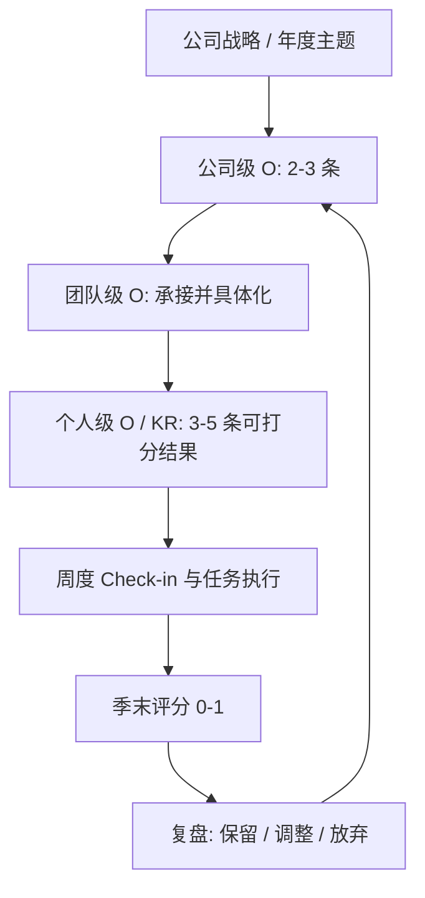

# 目标与关键结果（OKR, Objectives and Key Results）

2025200385 陈悦杰

---

## 一、定义：什么是 OKR

OKR 是 Objectives and Key Results 的缩写，中文一般译作"目标与关键结果"。它是一套目标管理方法，核心结构包括以下两个方面：

- **O（Objective，目标是定性的）**：说明本季度最希望改变什么、推动到哪里。表述需要有方向感与感召力，但不可直接验收。
- **KR（Key Result，关键结果是定量的）**：说明如何证明上述目标确实发生，一般以数字、时间节点或明确的交付物形式呈现。

两者配套使用，通常在一个 O 之下设置 3-5 条 KR。O 用于明确方向、形成共识，KR 用于提供可衡量的刻度，并作为季度末评分的依据。

举个例子，某内容平台团队这个季度的 OKR 是这样写的：

> **O：让"社交媒体分析"模块成为团队做选题决策的第一参考工具。**
>
> - KR1：季度内 80% 以上的周报选题会引用该模块输出的结论；
> - KR2：模块内 KPI 分析类需求的平均交付周期从 12 天缩短到 5 天；
> - KR3：月活使用该模块的团队数达到 5 个。

该例中有两点需要注意。其一，O 本身不含具体数值，其作用在于确定基调，若强行加入指标，则容易退化为一句口号。其二，KR1 表述为"决策会引用结论的次数"，而不是"提升团队的数据意识"——后者难以验证，季末只能依赖主观判断。

另有一个常见误解需要澄清：**KR 并非任务清单**。"上线 CRM 系统""完成 3 个版本发布"属于任务，而非 KR。判别方法较为直接：假设相应工作已经完成，但对应的指标并未发生变化，若 KR 仍被判定为完成，则该 KR 实质上描述的仍是任务。KR 描述的是结果，而非动作。

---

## 二、背景与上下文

### 2.1 发展脉络

OKR 起源于英特尔。20 世纪 70 年代，英特尔引入# 目标与关键结果（OKR, Objectives and Key Results）德鲁克的目标管理（MBO），但其指标偏财务、逐层下发，并未回答"公司究竟要成为什么"。安迪·格鲁夫为此提出一个著名问题：**"如果明天董事会把我们全换掉，新董事会会做什么决定？"** 这一问促使英特尔把目标聚焦到方向性判断上，形成 iMBO，即 OKR 的雏形。

Google re:（re:基金会）随后将这一做法整理并公开命名为 Objectives and Key Results，约翰·杜尔（John Doerr）大力推广，给出了较完整的操作范式：季度制定、周会更新、季末以 0-1 打分。Intel、Amazon、Meta 等公司均有公开实践。

国内真正流行是 2019 年前后。几本管理类的书把方法和工具流程讲清楚，加上飞书、企业微信这些平台把 OKR 做成线上功能，很多公司才开始按"周会更新 + 月度复盘 + 季度评分"跑起来。

近几年国内实践又出现几个新变化，值得补充说明：

**一是 OKR 与 KPI 融合，形成 MOKR 模式。** 纯粹按 Google re: 做法打分的企业相对有限，多数国内企业选择把 OKR 嵌入既有的绩效体系：用 O 承接部门责任，用 KR 中的量化条目充当考核指标，两套工具合用（MOKR，Objectives and Key Results and Measures）在国内互联网与制造业企业中被广泛采用。

**二是周期缩短与"轻量化"。** 除季度 OKR 外，部分企业开始试行月度甚至双周 OKR，配合敏捷迭代使用，工具形态从"季度考核表"变成"看板上的进度条"。

**三是工具平台化。** 飞书 OKR、企业微信、钉钉、Teambition、Worktile 等产品把 KR 进度更新、周会提醒、评分统计做成现成功能，员工不必自行维护文档，OKR 因此更容易在中小企业落地。

**四是与 AI、敏捷研发等新方法结合。** 2023 年以来生成式 AI 普及，模型效果、迭代速度这类指标难以事先设定目标，于是一些团队改用"方向性 O + 每周实验性 KR"的方式管理 AI 项目，OKR 的 KR 由固定承诺转向可调整的实验指标。

需要指出的是，OKR 在国内的热度与 HR SaaS 厂商的推动密不可分，公开材料中带有较强的宣传色彩；判断一家企业是否真正落地 OKR，不妨以"是否存在季度评分记录与复盘文档"作为检验标准。

### 2.2 OKR 的现实价值

**其一是缓解目标稀释。** 一个团队一个季度手中常有二三十项待办事项，却往往缺乏排序。OKR 要求一个周期只选定 3-5 个关键结果，迫使团队作出取舍——被舍弃的部分往往比被保留的部分更能说明该季度的重点。

**其二是区分工作投入与工作成果。** 传统汇报常以"本季度完成 18 项任务"说明价值，而 OKR 要求以"三条 KR 各自的得分"说明价值。前者衡量投入强度，后者衡量实际成果。

**其三是为跨部门协作提供共同坐标。** 公司级 O 逐层拆解为团队级 O 与个人级 KR，拆解过程中必须能够说明本条 KR 支撑的是上层哪一条 KR；若无法追溯，通常意味着该 KR 价值有限，或上层目标表述不清。

### 2.3 适用边界与局限

| 场景 | 说明 |
| --- | --- |
| 方向已经清晰，剩余工作为稳定交付 | 客服、运维、合规等岗位，OKR 所强调的挑战性易与流程稳定性要求相冲突 |
| 结果需较长周期方能显现 | 基础研究、大型基建工程等，一个季度内难以观察到变化，评分易失真 |
| 薪酬已直接与工时或计件挂钩 | 考核维度已经覆盖，再引入目标评分属重复考核 |

---

## 三、深入扩展：OKR 的内部逻辑与运作机制

### 3.1 好目标的写法（Objective）

一个好目标应当满足"**定性 + 有张力 + 可感召**"，常用检验句式："我希望/我们要让〔某对象〕在〔某方面〕达到〔方向性状态〕"。

| 反模式（把 O 写成 KR） | 改进写法 |
| --- | --- |
| 把 12 次培训做完 | 让新员工 2 周内能独立完成一次投放复盘 |
| 上线 CRM 系统 | 让销售线索从分配到跟进不再依赖微信群 |
| 提高代码质量 | 让核心模块的线上事故从每月 5 次降到 1 次以内 |

### 3.2 关键结果的四种类型

关键结果按"衡量对象"与"变化时点"两个维度可分为四类，实际使用时可对照下表判断：

| 类型 | 衡量对象 | 示例 | 优势 | 局限 |
| --- | --- | --- | --- | --- |
| 产出型（Output） | 可交付的成果或里程碑 | 完成 8 个分析模板并上线 | 进度可控、验收清晰 | 易退化为任务清单，对业务结果影响有限 |
| 结果型（Outcome） | 业务指标的实际变化 | 付费转化率由 2.1% 提升到 3.0% | 直接体现价值 | 归因困难，易受外部因素干扰 |
| 领先型（Leading） | 对结果有预测作用的先行指标 | 新增用户 7 日留存率 | 出现较早，便于及时纠偏 | 与最终结果的相关性需验证 |
| 滞后型（Lagging） | 滞后显现的财务或规模指标 | 年度营收、总 GMV | 权威、可对外披露 | 反馈过慢，季中期难以判断走向 |

实践建议：**每个 O 至少配置 1 条结果型 KR**，否则 OKR 容易退化为项目计划表。

### 3.3 评分机制与数学表达

谷歌 re: 的惯例是**季度结束后按 0-1 打分**（也可按 0-100 打分，两者等价）。设第 $i$ 条关键结果的目标值为 $T_i$、实际完成值为 $x_i$，其完成度记为 $r_i$。

**正向 KR（越大越好，如留存率、收入、交付量）：**

$r_i = \min\left(1, \frac{x_i}{T_i}\right)$

上限截断为 1，是为了避免超额完成带来"过度激励"，例如为拿高分而超额压低成本。

**逆向 KR（越小越好，如缺陷率、成本、流失率）：**

$r_i = \mathrm{clip}\left(0.7 + 0.3 \cdot \frac{T_i - x_i}{T_i}, 0, 1\right)$

其中 $\mathrm{clip}(a, 0, 1)$ 表示将结果限制在 0 至 1 之间。该式的含义是：问题完全清零（$x_i = 0$）记 1.0 分，刚好达标（$x_i = T_i$）记 0.7 分，未达标则按差距线性扣减。

**加权总分（各 KR 重要性不同）：**

$R = \sum_{i=1}^{n} w_i r_i$，其中权重满足 $\sum_{i=1}^{n} w_i = 1$ 且 $w_i > 0$

**打分档位（Google re: 惯例）：**

| 分数 | 含义 |
| --- | --- |
| 1.0 | 达成预期（stretch 目标完成） |
| 0.7 | 基本达标 / 部分完成 |
| 0.3 - 0.6 | 有实质性进展但未达标 |
| 0 - 0.2 | 基本失败，无有效进展 |

**过程指标：Check-in Rate（打卡率）** —— 指标是"目标被定期检查的比例"，是 OKR 是否"活着"的过程信号：

$\mathrm{CheckInRate} = \frac{n_{\mathrm{check}}}{n_{\mathrm{plan}}}$

其中 $n_{\mathrm{check}}$ 为周期内实际被检查更新的 KR 次数，$n_{\mathrm{plan}}$ 为按节奏应检查的次数。

谷歌 re: 建议周会中覆盖多数 KR，把 Check-in Rate 维持在 70% 左右；低于 50% 通常说明 OKR 已被搁置。

**KR 达成率的时间序列可进一步做统计监控**：设第 $t$ 周的实际值为 $x_t$、目标线为 $T_t$，可计算偏差 $\delta_t = x_t - T_t$；当 $|\bar\delta| > 2\cdot \frac{s_\delta}{\sqrt{n}}$（近似双侧显著性水平 $\alpha \approx 0.05$）时，应判定"进度偏离显著"，触发根因分析与纠偏。

### 3.4 节奏（Cadence）

| 频次 | 动作 | 责任人 |
| --- | --- | --- |
| 周（30-60 分钟） | Check-in：更新 KR 进度 0-1、红黄绿状态、提出阻塞项 | 直接下属汇报，上级只提问不点评 |
| 双周/月 | 复盘：看趋势与依赖关系，必要时微调 KR 定义（允许"改目标"） | 团队负责人 |
| 季末 | 评分：0-1 打分、对齐评级、提炼经验并写入"我们的经验"文档 | 上级 + 同事互评 |
| 季初 | 制定：自下而上起草 → 与上级/相关团队对齐 → 公开承诺 | 全员 |

**注意**：OKR 的评分在多数公司**不直接等同于奖金**（部分公司权重 10%-30%），这正是 OKR 敢设"stretch（挑战性）目标"的前提——评分用于复盘和学习，不用于惩罚。

### 3.5 从战略到执行的链路

关键机制：**对齐（Alignment）**。团队级 KR 必须能追溯到上层 KR；如果无法追溯，说明要么该 KR 价值低，要么上层目标描述不清。

---

## 四、举例说明

### 4.1 真实案例一：Intel——"如果被换掉的董事会"如何变成一个战略决策

1965 年公司成立后不久，英特尔即进入存储器芯片市场，此后十余年业绩一路下滑。1985 年，安迪·格鲁夫向 CEO 摩尔提出那个著名的问题：**如果我们被赶出董事会，换一批新董事进来，他们会做什么决定？** 答案是显而易见的——存储器业务不会得到批准。英特尔随后退出 DRAM，将资源集中到微处理器业务，公司由此走向后来的主导地位。

这个案例说明 OKR 最初的用途：**它首先是战略判断工具，而不是考核工具。** O 提出的问题（我们要成为什么）与 KR 提供的证据（哪些业务应当被放弃）服务于重大取舍，与个人绩效无关。

### 4.2 真实案例二：Google re: 官方指南中的标准示例

Quantive 发布的《A Guide to OKRs》（源自 Google re: 的实践）给出了一个被广泛引用的模板：某公司希望拓展海外市场，其 O 设定为在德国市场建立业务规模，KR 相应设定为月活用户数达到 10 万、品牌认知度调查提升 20%、新增 10 家本地渠道合作伙伴。这份指南同时确立了 0-1 评分制：0.7 视为达标基准，1.0 表示挑战性目标被超越。

这一示例值得注意的地方在于，它同时体现了 OKR 的三个特点：O 是方向判断而非数字；KR 全部可量化；**KR 不用于发放奖金**——指南明确建议不要将 OKR 评分直接与薪酬挂钩。

### 4.3 真实案例三：Netflix——没有 OKR 评分体系，却实现了更彻底的对齐

Netflix 自 2009 年前后起在内部推行**季度策略文档（Strategy Doc）**：每季度由团队撰写约十余页文档，说明本季度最重要的几件事、明确"本季度不做什么"，并附上详细的财务测算与情景分析（若某项假设成立会怎样）。文档向全员开放，并举办有高层参加的"战略沟通会"进行讲解。

Netflix 并不以 OKR 分数考核员工，其公开表述也强调"不要把人当成记分卡"。但从功能上看，季度策略文档承担的正是 OKR 的**对齐与聚焦**职能。这一对比恰好印证了本章第六节的判断：**对齐与评价本可分开，多数组织的问题不在于缺少 OKR，而在于把二者混为一谈。**

### 4.4 教学示例：把模糊表述改写为可验收的 KR

以下为说明方法所用的教学示例，并非特定企业的真实数据。假设某增长团队拿到手的目标是"下季度把品牌影响力做上去"——该表述无法反驳，也无法验收。改写如下：

| 改写前（不可验收） | 改写后（可验收） |
| --- | --- |
| 把品牌影响力做上去 | O：让目标用户在选购前主动搜索并了解我们的产品 |
| 多做内容曝光 | KR1：品牌词月搜索量从 8000 提升到 20000 |
| 参加行业活动 | KR2：活动中获得的 MQL（市场有效线索）达到 120 条，其中 30 条进入销售跟进 |
| 让内容更容易被传播 | KR3：内容被第三方媒体转载的篇数从每季 5 篇增至 20 篇 |

**写法要点**：不写"提高影响力"，而写"目标用户做了什么动作"。影响力属于他人的印象，难以衡量；搜索、留线索、被转载均可计数。同理，"让用户更满意"应落到"满意度评分从 4.1 提升到 4.6"，"提高响应速度"应落到"工单首次响应时长从 8 小时降至 2 小时以内"。

### 4.5 教学示例：逆向 KR 与加权评分的计算

某制造业团队（教学示例）的季度 OKR 为"降低交付环节的质量波动"，KR 设定为：投诉率从 $2.4\%$ 降至 $1.5\%$ 以下；返工工时占比从 $9\%$ 降至 $5\%$；关键工序过程能力指数 $C_{pk}$ 从 0.95 提升至 1.20。假设季末实际完成情况与权重如下：

| KR | 方向 | 权重 $w_i$ | 目标值 $T_i$ | 实际值 $x_i$ | 完成度 $r_i$ |
| --- | --- | --- | --- | --- | --- |
| KR1 客户投诉率 | 逆向 | 0.4 | 1.5% | 1.8% | $0.7 + 0.3 \times (-0.2) = 0.64$ |
| KR2 返工工时占比 | 逆向 | 0.35 | 5% | 6% | $0.7 + 0.3 \times (-0.2) = 0.64$ |
| KR3 过程能力指数 $C_{pk}$ | 正向 | 0.25 | 1.20 | 1.08 | $\min(1, 1.08 / 1.20) = 0.90$ |

$R = 0.4 \times 0.64 + 0.35 \times 0.64 + 0.25 \times 0.90 = 0.705$

按 3.3 节的档位标准，$0.705$ 属于"基本达标"。同时应注意：此例三条 KR 均为逆向或技术性指标，缺少结果型业务指标，若照搬执行，容易退化为质量部门的内部考核表；改进办法是补充一条结果型 KR，如"因质量问题导致的订单流失金额下降 30%"。

---

## 五、对比分析：OKR 与相似概念的区别

| 维度 | OKR | KPI | MBO（目标管理） | BSC（平衡计分卡） | 项目/任务清单 |
| --- | --- | --- | --- | --- | --- |
| 本质 | 战略沟通与聚焦工具 | 考核指标体系 | 目标设定方法论 | 战略因果框架 + 考核工具 | 执行调度工具 |
| 数量 | 每周期 3-5 个 | 5-20 个指标 | 若干 | 4 维度数十个 | 不限 |
| 是否量化 | KR 必须量化 | 必须量化 | 部分量化 | 必须量化 | 不要求 |
| 性质 | 定性目标 + 定量结果 | 全部定量 | 偏定量 | 全部定量 | 定性描述为主 |
| 时间跨度 | 1 个季度（可延长） | 月/季/年 | 1 年 | 1-5 年 | 天/周 |
| 与考核挂钩 | 部分公司轻挂钩 | 通常强挂钩 | 强挂钩 | 强挂钩 | 通常不挂钩 |
| 目标是否"可拉伸" | 鼓励 stretch（挑战性） | 一般"够得着" | 一般可达 | 可拉伸 | 视任务而定 |
| 失败代价 | 低（重在对齐与学习） | 高（直接影响奖金） | 高 | 高 | 低 |

**几个最容易混淆的点：**

1. **OKR ≠ KPI。** KPI 是"衡量公司健康度的仪表盘读数"，追求稳定与可控；OKR 的 KR 是"本季度要推动的刻度"，追求挑战与突破。实践中常把 KR 做成 KPI 形态，于是"设为挑战性目标"变成口号。
2. **OKR ≠ 任务清单。** "完成 3 个版本发布"是任务；"把崩溃率从 1.2% 降到 0.3% 以下并连续 8 周保持"是 KR。检验方法：问"如果这件事做完了但指标没变，KR 算完成吗？"若答案为"算"，则大概率是任务型 KR。
3. **OKR ≠ 战略。** 战略回答"我们为什么赢"（方向选择），OKR 回答"这个季度如何在某一维度上可验证地推进"（路径与刻度）。一份战略可以支撑多个季度的 OKR。
4. **OKR ≠ "目标"。** 企业常有目标体系（如北极星指标），OKR 是实现目标的**季度落地机制**：目标回答"最终要什么"，KR 回答"本季度交什么结果才算数"。

---

## 六、小结

OKR 由定性的目标与定量的关键结果两部分构成，通过"一个周期只做 3-5 个关键结果"解决目标稀释问题，完成度按 $r=\min(1, x/T)$（逆向指标相应调整）计算并加权汇总，季末按 0-1 打分、以周度 Check-in 维持过程有效性。相较 KPI 与 BSC，OKR 的重心不在考核而在聚焦与对齐：它回答的是"这个季度把力气放在哪里"，而不是"某个人值多少"。

这一区别也决定了它的局限。一旦将 KR 得分与奖金直接挂钩，指标的博弈风险随之上升：拆分难度、替换代理指标、刷高可量化的数字，都会使得分偏离真实进展（Goodhart 定律）；团队成果本就受上级决策、跨部门配合与外部环境影响，难以归因到个人，运气与判断力也无法区分；基础研究、平台维护等难以量化的工作则会被系统性挤压，季度节奏还会诱导组织把资源从长期投入移向当期指标。目标设定研究同样表明，具体而有难度的目标仅对简单、可量化、路径明确的任务有效，对复杂与创造性任务效果减弱，甚至因数据造假与目标窄化带来负面后果（Ordóñez et al., 2009）。因此较为稳妥的做法是：由 OKR 承担对齐与牵引功能，绩效判断交由校准会议、行为锚定评价、持续绩效管理等独立机制承担，KR 数据至多作为参考项，而不作为奖金换算依据。

---

### 附：术语中英对照

| 缩写 | 英文 | 中文 |
| --- | --- | --- |
| O | Objective | 目标 |
| KR | Key Result | 关键结果 |
| KOI / KPI | Key Objective Indicator / Key Performance Indicator | 关键目标/绩效指标 |
| Check-in | Check-in | 定期进度更新（周会打卡） |
| Alignment | Alignment | 上下级/跨团队对齐 |
| Stretch Goal | Stretch Goal | 挑战性目标 |
| Cadence | Cadence | 运营节奏（周/月/季） |
| Retrospective | Retrospective | 复盘 |
